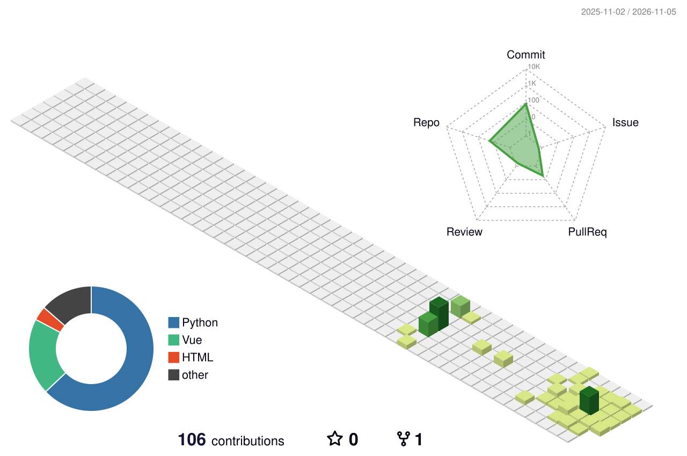

# marlanee

SSAFY에서 Python으로 알고리즘을 공부하고, Django 웹 서비스와 문서 검색을 활용한 AI 프로젝트를 만들고 있습니다.

[학습 기록 · TIL](https://github.com/marlanee/TIL)

## 프로젝트

### 책갈피 · Django 독서 기록 서비스

회원 인증, 도서 등록·조회·수정·삭제, 제목·저자 검색, 독서 프로필을 갖춘 SSAFY 프로젝트입니다. 화면을 직접 확인하면서 도서 데이터와 모바일 가독성의 개선 방향을 정했고, Codex를 활용해 구현과 검증을 진행했습니다.

[소스와 실행 방법](https://github.com/marlanee/thread-reading-pjt/tree/main/pjt04-bookmark) · [역할과 검증 기록](https://github.com/marlanee/thread-reading-pjt/blob/main/docs/projects/2026-10-29-bookmark.md)

같은 저장소의 [ThRead](https://github.com/marlanee/thread-reading-pjt)에는 HTML·CSS·JavaScript로 만든 반응형 도서 탐색 화면도 있습니다.

### Scene & Source · 근거 기반 영화 지식 서비스

영화 장면의 과학·역사적 배경을 설명할 때, 답변에 사용한 위키백과와 공식 PDF의 원문을 함께 보여줍니다. 서비스 범위와 화면 방향을 정하고, Codex를 활용해 FastAPI·LangGraph 기반으로 구현하고 동일 질문의 검색 방식과 RAG 사용 전후를 비교했습니다.

[프로젝트와 소스](https://github.com/marlanee/AI_project_2) · [실험과 검증 기록](https://github.com/marlanee/AI_project_2/blob/main/docs/validation.md)

### 배틀싸피 파이썬 랩 · 브라우저 실습실

BFS, 경로 복원, 이동·사격 판단을 작은 과제로 연습하는 개인 학습실입니다. Pyodide로 브라우저에서 Python을 실행하며, 턴별 시뮬레이션으로 선택한 행동을 확인할 수 있습니다.

[프로젝트와 실행 방법](https://github.com/marlanee/battlessafy-python-lab)

## 요즘 공부하는 것

- **알고리즘** — BFS·다익스트라에서 방문 상태를 어떻게 잡는지, 백트래킹에서 무엇을 복구해야 하는지 풀이와 백지 복습으로 확인합니다.
- **빅데이터분석기사 실기** — Pandas로 결측치·그룹 집계를 다루고, scikit-learn으로 학습·평가 데이터를 나눠 랜덤 포레스트 분류를 연습합니다.

GitHub 기여 그래프

