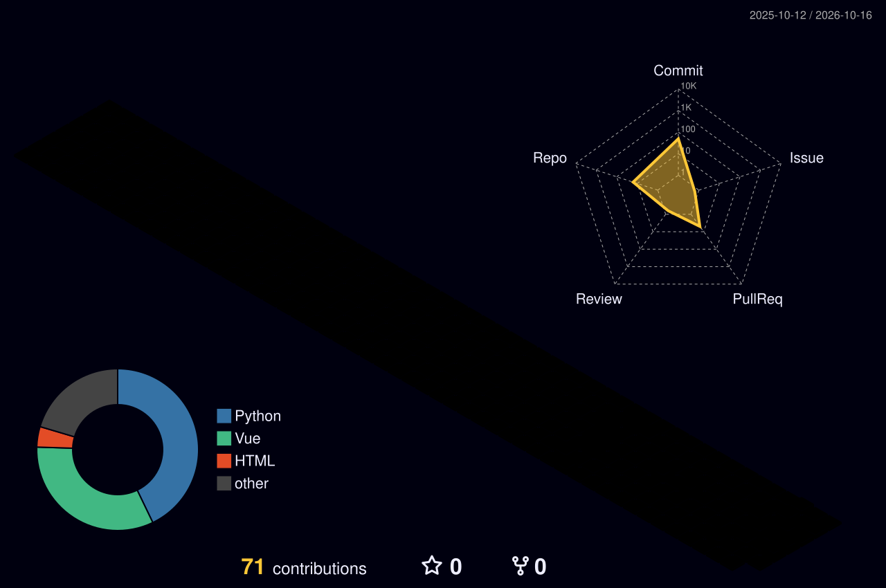

### Personal stats:

<b>Highlights / Proficiencies</b>

- SSAFY 1개월 차 열정 개발자
- 알고리즘 및 백엔드 집중 학습 중

### 💪 Skills

---

### 📊 3D Contribution Stats

### 📚 프로젝트 · 책갈피 (2026.10.29)

Django 회원 인증과 도서 CRUD·검색·독서 프로필을 갖춘 SSAFY PJT 04 결과물입니다.

- [소스 및 실행 방법](https://github.com/marlanee/thread-reading-pjt/tree/main/pjt04-bookmark)
- [과정·검증·이력서용 요약](https://github.com/marlanee/thread-reading-pjt/blob/main/docs/projects/2026-10-29-bookmark.md)
- Python 3.11.9 / Django 5.2.6 / SQLite / Bootstrap 5.3.3
- 로컬 자동 테스트 20개, 실행 캡처 21장, 재실행 가능한 도서 데이터 로드
- 서비스 요구 및 20~30대 UI 방향을 정하고 Codex를 구현·검증·문서화에 활용했습니다. 상세 역할과 검증 한계는 프로젝트 기록에 정리했습니다.
